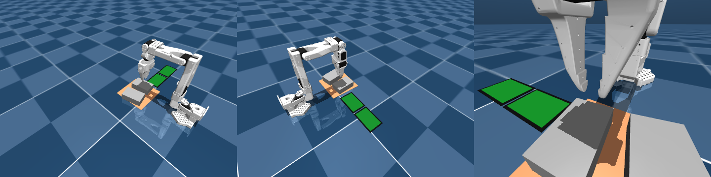

# SO-101 정밀 배치 시뮬레이션

[](https://github.com/wonyoungjacob/so101-sim/actions/workflows/tests.yml)

연구실의 **실물 SO-101 셋업(카메라 3대, 콘크리트 블록 2개, 목표 칸 2개)을 MuJoCo로 옮긴 모방학습 환경**이다.
IK 전문가 시연 자동 수집 → LeRobot 데이터셋 변환 → 정책 4종(ACT · Diffusion · SmolVLA · π0.5) 학습 → 같은 평가 시드에서 상대 비교까지의 파이프라인을 담았다.



## 현재 상태

| 단계 | 상태 |
|---|---|
| 실물 셋업 → MJCF 장면 (좌표 · 블록 치수 · 질량 · ChArUco 캘리브레이션 카메라) | 완료 |
| gymnasium 환경, 조적 검측식 오차 지표 | 완료, 단위 테스트 있음 |
| IK 전문가 시연 수집 (품질 게이트 포함) | 완료 |
| LeRobot 변환 · 학습 · 롤아웃 · 4정책 비교 스크립트 | 작성 완료 |
| **4정책 학습 · 비교 결과** | **아직 없음** (GPU 서버에서 실행 예정) |

결과가 나오기 전이므로 이 저장소에는 성능 수치를 적지 않았다. 같은 연구실의 3단 벽 실험(MuJoCo, UR10e, 100벽 평가)은 [masonry-inspection-il](https://github.com/wonyoungjacob/masonry-inspection-il)에 있다.

## 과제 정의

| 항목 | 값 |
|---|---|
| 로봇 | SO-101 (5축 + 그리퍼). 모델은 MuJoCo Menagerie의 SO-ARM100 MJCF를 프록시로 사용 |
| 물체 | 콘크리트 블록 2개, 90 × 57 × 30 mm, 25.1 g (실물 벽돌 밀도로 환산) |
| 시작 배치 | 배치 A/B 중 하나 + 블록마다 위치 ±10 mm · yaw ±14° 연속 무작위, 겹침 · 도달 불가는 다시 뽑음 |
| 관측 | 카메라 3대(앞 2 · 손목 1, 320 × 240) + 관절각 6 |
| 행동 | 관절 절대각 6 (실물 서보 명령과 1:1) |
| 성공 | 블록 i가 목표 i에 놓임. target1 < 3 mm, target2 < 5 mm (조적 검측식 gauge) |
| 제어 / 저장 | 제어 100 Hz, 데이터셋은 20 Hz로 솎아 저장. 롤아웃은 정책 행동을 5스텝씩 반복해 레이트를 맞춤 |
| 평가 | 학습 시드(20260624~)와 겹치지 않는 평가 시드(70000000~)에서 상대 비교 |

### 왜 중심 거리가 아닌 "조적 검측식" 오차인가

현장에서 벽돌 3 mm 허용오차는 수평실 · 레벨 · 직선자로 **블록 면**을 재서 확인한다. 그래서 블록을 중심점이 아니라 **꼭짓점 8개**로 보고,
기준 자세와의 편차를 도구 방향(길이 · 면 · 높이)으로 나눠 그 최댓값(gauge)으로 합격을 판정한다([envs/masonry_metrics.py](envs/masonry_metrics.py)).
중심이 정확해도 2° 돌아가면 면 끝에서 1.5 mm 넘게 어긋나는데, 중심 거리 지표는 이를 0으로 본다. 이 차이는 [tests/test_masonry_metrics.py](tests/test_masonry_metrics.py)가 확인한다.

## 설계 결정과 실패 기록

| 결정 | 이유 · 겪은 문제 |
|---|---|
| 행동 = 관절 절대각 | 실물 SO-101 서보 명령과 1:1. 5축 팔이라 EEF 6D 명령은 IK가 과제약됨. EEF pose도 함께 저장해 두어 나중에 행동 공간만 바꿔 실험 가능 |
| 목표 칸 2개를 −X로 30 mm 평행 이동 | 실측 좌표 그대로면 프록시 팔이 target2를 수직으로 내려놓지 못함(도달 범위 부족). 수직 도달이 가능한 최소량만 옮기고 상대 배치는 유지 |
| target2 허용오차 5 mm | 도달 한계 근처라 3 mm를 일관되게 못 맞춤. 4정책에 똑같이 적용하므로 상대 비교에는 영향 없음 |
| 놓기 오프셋 피드포워드 | target2에서 IK + 놓기가 항상 같은 방향으로 약 (+9.4, +7.7) mm · yaw +5.8° 치우침을 여러 시드로 확인 → 미리 빼서 조준. 놓은 뒤 다시 옮기는 보정은 **쓰지 않음**(재배치 동작은 모방학습에 치명적) |
| 수집 게이트 10 mm | 수직 1회 배치만 허용하되 두 블록 모두 10 mm 이내인 시연만 채택. 파지 실패(수십 ~ 수백 mm)는 버림 |
| grasp_site를 손가락 끝으로 | 손바닥 기준으로 집으면 손끝이 바닥과 충돌 |
| 디버그 마커 렌더 제외 | grasp_site 같은 표식은 실물 카메라에 없으므로 정책 관측 렌더에서 숨김 |
| 저장소 루트로 `chdir` 후 상대 경로 로드 | MuJoCo가 Windows 비ASCII(한글) 절대 경로에서 파일 I/O에 실패 |
| 실물 카메라 반영 | ChArUco 캘리브레이션 외부 · 내부 파라미터를 MuJoCo 카메라 pos/xyaxes/fovy로 변환([scripts/apply_camera_calib.py](scripts/apply_camera_calib.py)). 렌즈 왜곡은 핀홀이라 미반영 |
| 손목 카메라 위치 | 3D 프린팅한 손목 마운트([hardware/](hardware/wrist_cam_mount/))의 카메라 창 중심 · 법선을 Fusion 360 스크립트 또는 STL 분석으로 추출([tools/](tools/)) |

## 저장소 구조

```
config.py              좌표계 · 단위(SI) · 치수 · 임계값 (값마다 근거 주석)
envs/
  so101_place_env.py   gymnasium 환경 (관측 3캠 + 관절, 행동 관절 6)
  ik.py                DLS IK (완전 자세 / 수직축만 정렬하고 yaw 자유)
  masonry_metrics.py   조적 검측식 오차 (longitudinal · lateral · level · plumb · gauge)
assets/so101/          SO-ARM100 MJCF (MuJoCo Menagerie, Apache-2.0) + 배치 장면 place_scene.xml
scripts/               수집 · 변환 · 롤아웃 · 비교 · 시각화 · 카메라 캘리브레이션
hardware/              손목 카메라 마운트 STL
tools/                 손목 카메라 프레임 추출 (Fusion 360 스크립트, STL 분석)
tests/                 지표 · 장면 · IK 테스트 (렌더러 불필요)
docs/PIPELINE.md       4정책 학습 · 비교 전체 절차
```

## 실행

```bash
pip install -r requirements-dev.txt            # 시뮬레이션 · 수집 · 테스트 (GPU 불필요)
pytest                                         # 9개
python scripts/view.py                         # 전문가 시연을 MuJoCo 창에서 반복 재생
python scripts/collect_dataset.py --num 50 --fresh   # 시연 50개 → out/episodes/*.npz
```

학습과 4정책 비교(GPU 서버, LeRobot 0.5.1)는 [docs/PIPELINE.md](docs/PIPELINE.md).

## 한계

- SO-101 전용 MJCF가 아니라 **SO-ARM100 모델을 프록시**로 썼다. 링크 길이 차이 때문에 목표 칸을 30 mm 옮겼다.
- 렌즈 왜곡, 조명, 텍스처는 실물과 다르다. 목표는 sim2real 수치 예측이 아니라 **같은 조건에서 정책끼리의 상대 순위** 비교다.
- 시연은 사람 텔레오퍼레이션이 아니라 IK 스크립트다. 사람 시연의 다양성 · 망설임은 없다.

## 만든 사람

정원영 (연세대 건설환경공학과, 스마트인프라연구실 학부연구생). 연구실의 실물 SO-101 셋업을 시뮬레이션으로 옮기려고 만들었다.

로봇 모델: [MuJoCo Menagerie](https://github.com/google-deepmind/mujoco_menagerie) `trs_so_arm100` ([The Robot Studio](https://www.therobotstudio.com/) SO-ARM100 기반, Apache-2.0, [assets/so101/LICENSE](assets/so101/LICENSE)).
